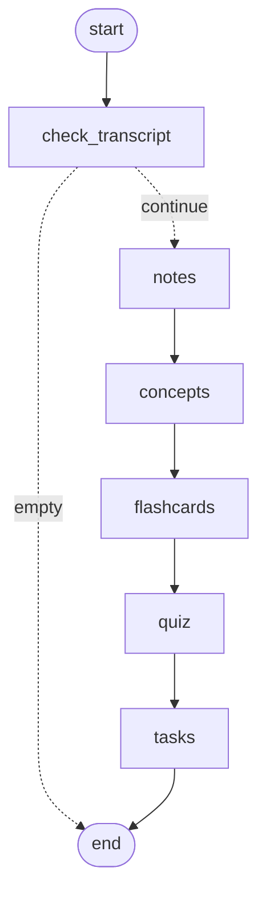

# ai-note-taker

[](https://github.com/Aksh-99/ai-note-taker/actions/workflows/ci.yml)

An AI note taker that listens to lecture recordings and turns them into study material. Built end to end on free, open models.

**What it does**
- Transcribes lectures with Whisper (fine-tuned for technical vocabulary)
- Writes structured notes, key concepts, flashcards, and quizzes
- Pulls out deadlines and assignments into a to-do list and calendar file
- Lets you search across every lecture you've recorded, with answers cited to the exact timestamp

**What makes it an ML engineering project, not just an API wrapper**
- A real evaluation set with word error rate and technical-term recall
- LoRA fine-tuning of Whisper with before/after results
- Quantization with speed vs accuracy tradeoffs
- Retrieval evals (recall@k, MRR) for the search feature
- CI, Docker, and a deployed demo

## Stack
Python · faster-whisper · Hugging Face Transformers + PEFT · Ollama / Groq free tier · LangGraph · sentence-transformers · FAISS · FastAPI · Gradio · GitHub Actions · Hugging Face Spaces

## Requirements
Python 3.10+ and [ffmpeg](https://ffmpeg.org/) for decoding audio (`sudo apt install ffmpeg`, `brew install ffmpeg`, or `winget install ffmpeg`). Then install the package with `make install`.

Whisper model weights are not installed with the package. faster-whisper downloads them for free from the Hugging Face Hub the first time a model is used (about 75 MB for `tiny`, 480 MB for `small`) and caches them for later runs.

## Configuration
All settings come from environment variables (prefixed `NOTETAKER_`) or a local `.env` file. Start from the template, then check what the app picked up:

```bash
cp .env.example .env
notetaker config
```

The defaults are free and local (faster-whisper `small`, Ollama), so no API key is needed. `.env` is gitignored.

## Usage
Transcribe a lecture recording (any format ffmpeg reads, including video):

```bash
notetaker transcribe lecture01.mp3                 # writes outputs/lecture01/
notetaker transcribe lecture01.mp4 -m base -l en   # smaller model, skip language detection
```

Each run writes two files: `transcript.json` (segments, word timestamps, and confidence scores, used by every later step) and `transcript.md` (readable paragraphs, each labelled with its start time like `[00:12:41]`). Run `notetaker transcribe -h` for all options.

Long recordings are split automatically at pauses into pieces of at most 5 minutes, transcribed one at a time, and stitched back together with correct timestamps, so a 90-minute lecture never goes to Whisper in one call. Change the limit with `--max-chunk-seconds` (or `NOTETAKER_CHUNK_MAX_SECONDS`); `0` turns splitting off.

Compare the speed and memory of Whisper sizes on your own machine:

```bash
notetaker benchmark lecture01.mp3 -m tiny base small --max-seconds 600 --repeats 3
```

This writes `reports/benchmark/benchmark.md` (a table of load time, transcription time, real-time factor, and peak RAM per model) plus `benchmark.json`. Each model runs in its own fresh process so its memory number is not inflated by the models measured before it. Run it once beforehand so model downloads are not counted in the load times.

Download the evaluation set (MIT OpenCourseWare lectures plus their official human-made captions, used as reference transcripts for measuring accuracy):

```bash
notetaker evalset --list                      # show the lectures in eval/ocw_lectures.json
notetaker evalset                             # audio + transcripts into data/raw/ocw/<id>/
notetaker evalset --only mit-18.06-lec01      # just one lecture
notetaker evalset --no-audio                  # transcripts only (a few KB each)
```

Each lecture folder gets `audio.flac` (16 kHz mono, ready for Whisper), `reference.json` (timed caption cues), `reference.txt`, and `meta.json` (source URLs, license, date). Only the audio track is saved; the video is streamed through ffmpeg and never stored. Re-running skips what is already there (`--force` re-downloads). OCW material is CC BY-NC-SA licensed and large, so `data/raw/` is gitignored and each person downloads their own copy. If OCW changes a page layout, add `audio_url` / `transcript_url` to that lecture in the manifest.

Before transcripts are scored, both the model output and the reference go through the same text normalizer (lowercase, no punctuation, caption tags and speaker labels removed, numbers spelled out, filler words dropped), so only real recognition mistakes count. To see exactly what the scorer will compare:

```bash
notetaker normalize data/raw/ocw/mit-18.06-lec01/reference.json
notetaker normalize out/transcript.json --keep-digits --keep-fillers
```

Score a model on the evaluation set with word error rate (WER) and character error rate (CER). Transcribe each lecture into `outputs/eval/<model>/<id>/`, then point `notetaker wer` at that folder:

```bash
for d in data/raw/ocw/*/; do
  id=$(basename "$d")
  notetaker transcribe "$d/audio.flac" -m small -l en -o "outputs/eval/whisper-small/$id"
done
notetaker wer --hyps outputs/eval/whisper-small            # all lectures, report in reports/wer/
notetaker wer --hyps outputs/eval/whisper-small --max-seconds 600   # first 10 minutes only
notetaker wer reference.txt my_transcript.txt              # quick score of one pair
```

This writes `reports/wer/<system>.md` (per-lecture WER, substitutions / deletions / insertions, CER, and the most common word confusions), `<system>.json`, and `reports/wer/summary.md`, a table with one row per model that is rebuilt every time a new model is scored. The headline number is pooled WER: total errors divided by total reference words across all lectures.

WER weighs every word equally, but for lecture notes the technical vocabulary matters most. Technical-term recall counts how many of the curated terms in `eval/technical_terms.json` (about 60 terms such as "eigenvalue", "dynamic programming", "sample space", "backpropagation", each with the spellings that count as the same term) that the lecturer said also appear in the transcript:

```bash
notetaker terms --hyps outputs/eval/whisper-small          # all lectures, report in reports/terms/
notetaker terms reference.txt my_transcript.txt            # quick check of one pair
```

This writes `reports/terms/<system>.md` (recall and precision per lecture, recall by subject, and the most-missed terms), `<system>.json`, and `reports/terms/summary.md`. Counts are clipped, so a term earns at most as many hits as it was spoken; precision shows whether the model writes jargon that was never said. Edit the term list freely to match your own courses.

Once at least one model has a WER report, combine everything into the baseline report, the reference point for later fine-tuning and quantization:

```bash
notetaker baseline                    # reads reports/wer, reports/terms, reports/benchmark
notetaker baseline --rtf-budget 1.0   # allow slower models in the recommendation
```

This writes `reports/baseline.md` and `reports/baseline.json`: one row per model size with WER, CER, term recall, real-time factor and RAM, the Pareto frontier (models no other model beats on both accuracy and speed), the most accurate model within the speed budget, and what each step up in size buys in WER versus extra compute. Report names are matched across folders, so `whisper-small` in the WER report and `small` in the benchmark land in the same row. See `reports/baseline.md` for the full command loop.

### LLM setup (for notes, flashcards, quizzes and the agent)

Notes generation talks to an LLM through one client (`src/notetaker/llm.py`) that supports three free options. Pick one with `NOTETAKER_LLM_PROVIDER` in `.env`:

| Provider | Cost | Setup | Default model |
|---|---|---|---|
| `ollama` (default) | free, runs locally | install [Ollama](https://ollama.com), then `ollama pull llama3.1:8b` | `llama3.1:8b` |
| `groq` | free tier, rate-limited | free key from console.groq.com, set `GROQ_API_KEY` | `llama-3.1-8b-instant` |
| `huggingface` | free monthly credits | free token from huggingface.co/settings/tokens, set `HF_TOKEN` | `meta-llama/Llama-3.1-8B-Instruct` |

Check that it works:

```bash
notetaker llm "Explain eigenvalues in one sentence"
notetaker llm "List three linear algebra terms" --json --provider groq
```

Rate limits (HTTP 429) and server errors are retried with exponential backoff (1s, 2s, 4s, ...), honoring the server's `Retry-After`. Tests never call a real LLM: they use a fake transport or `FakeLLMClient`.

Turn a transcript into structured study notes:

```bash
notetaker notes outputs/lecture01/transcript.json              # notes.md + notes.json next to it
notetaker notes outputs/lecture01/transcript.json -p groq --chunk-words 2000
```

The transcript is split into chunks of about 1,200 words (a few minutes of speech, cut only at pauses). Each chunk goes to the LLM, which returns JSON sections (heading, one-line summary, key points, start time). Replies are validated, and broken JSON is sent back to the model once with the error so it can fix it. Every section heading carries a timestamp like `[00:12:41]`; timestamps the model invents outside its chunk are replaced by the chunk's start, so they always point at a real moment in the recording.

Then a "reduce" step merges the per-chunk sections into the lecture's main topics, adds a short overview and key takeaways (map-reduce summarization, `src/notetaker/mapreduce.py`). The model only groups numbered sections and writes the new headings and summaries; each topic's timestamp and key points are copied from its sections in code, with near-duplicate points removed, so nothing is invented and nothing is lost. If the section list is too long for one prompt (`--reduce-words`, default 2,500), it is merged in batches and then merged again. `--no-reduce` keeps the plain per-chunk notes, and if merging fails the per-chunk notes are still written.

Extract a glossary of key concepts and their definitions:

```bash
notetaker concepts outputs/lecture01/transcript.json           # concepts.md + concepts.json next to it
notetaker concepts --schema                                     # print the JSON Schema of concepts.json
```

Each chunk goes to the LLM, which lists the technical terms explained in it with a definition and any aliases (e.g. "SVD"). Replies are validated with pydantic (broken JSON gets one repair attempt). A term that does not actually occur in the chunk is dropped and reported, the same concept found in several chunks is merged into one entry (matched on its name or aliases, ignoring case, punctuation and plurals), and timestamps are found by searching the transcript, not asked from the model: each entry lists the time of every paragraph that mentions it. The output file has a published schema in [`schemas/concepts.schema.json`](schemas/concepts.schema.json), and `load_concepts` re-validates it on read, so later steps (flashcards, quizzes) can trust its shape.

Turn a lecture into flashcards you can study in Anki:

```bash
notetaker flashcards outputs/lecture01/transcript.json                     # flashcards.md + .json + .csv
notetaker flashcards outputs/lecture01/transcript.json \
    --concepts outputs/lecture01/concepts.json --deck "Linear Algebra::L01" # add glossary cards
notetaker flashcards --concepts-only --concepts outputs/lecture01/concepts.json  # no LLM calls at all
```

The LLM writes up to 6 question/answer cards per chunk. A card is kept only if at least half of its answer's content words (ignoring words like "the" or "is") occur in the transcript chunk, so answers built from outside knowledge are dropped. Each card gets the timestamp of the paragraph it overlaps most, repeated questions are removed, and `--concepts` adds a "What is X?" card for every glossary entry. `flashcards.csv` imports directly with Anki's File > Import: header lines set the deck, note type and tags (use `--plain-csv` for Anki older than 2.1.55). The JSON format is published in [`schemas/flashcards.schema.json`](schemas/flashcards.schema.json).

Make a multiple-choice practice quiz:

```bash
notetaker quiz outputs/lecture01/transcript.json                          # quiz.md + quiz.json
notetaker quiz outputs/lecture01/transcript.json --concepts outputs/lecture01/concepts.json
notetaker quiz --concepts-only --concepts outputs/lecture01/concepts.json  # no LLM calls at all
```

For each chunk the LLM writes up to 4 questions, each with the correct answer and 3 distractors as separate fields. The code builds the options and shuffles them with a fixed seed (`--seed`), because models tend to put the right answer first. A question is kept only if its correct answer is grounded in the transcript (same content-word test as the flashcards), options that repeat each other or say "all/none of the above" trigger a repair request, and each question links to the paragraph it is about. `--concepts` adds "which term matches this definition?" questions whose wrong options are the glossary terms introduced closest in time, with the term masked out of its own definition. `quiz.md` lists the questions with an answer key at the end, and the CLI reports how often the correct answer is the longest option (a classic giveaway; about 25% is fair with 4 options). The JSON format is published in [`schemas/quiz.schema.json`](schemas/quiz.schema.json).

Check that generated material only says what the lecture says (Step 3.7):

```bash
notetaker faithfulness outputs/lecture01/notes.json -p groq -m llama-3.3-70b-versatile   # LLM judge
notetaker faithfulness outputs/lecture01/quiz.json --max-claims 30                        # sample 30 claims
notetaker faithfulness outputs/lecture01/notes.json --lexical-only                        # free, no LLM
```

The file (notes, concepts, flashcards or quiz) is split into claims, one per key point, definition, card or question. For each claim the transcript paragraphs most likely to back it are retrieved by IDF-weighted word overlap, and a free judge model labels each claim `supported`, `partial`, `unsupported` or `contradicted` at temperature 0, copying an exact quote as evidence. The code checks that every quote really occurs in the transcript; a "supported" verdict with a missing or invented quote only counts half in the strict score. The report (`faithfulness_<kind>.md` + `.json`) gives faithfulness, strict faithfulness, hallucination rate, agreement with a word-overlap baseline (Cohen's kappa) and a list of claims to review with timestamps. Use a different, ideally larger, model as judge than the one that wrote the notes: LLM judges favour their own writing, and the CLI warns if they are the same. The JSON format is published in [`schemas/faithfulness.schema.json`](schemas/faithfulness.schema.json).

Run the whole pipeline in one command (Step 4.1):

```bash
notetaker agent outputs/lecture01/transcript.json                 # every stage, all files next to it
notetaker agent outputs/lecture01/transcript.json --steps notes quiz -p groq
notetaker agent outputs/lecture01/transcript.json --lecture-date 2026-11-11   # dated to-dos
notetaker agent outputs/lecture01/transcript.json --steps tasks --no-task-llm  # offline, no LLM
notetaker agent --graph                                            # print the graph as Mermaid
```

The stages are nodes of a [LangGraph](https://github.com/langchain-ai/langgraph) graph (`src/notetaker/agent.py`) that share one state, so later stages reuse earlier results: flashcards and quiz automatically get the glossary from the concepts stage, with no files passed by hand. A first node stops the run before any LLM call if the transcript is empty (a conditional edge). If one stage fails, the error is recorded and the other stages still run and write their files; the command then exits with code 1. Stages run one after another to stay inside free-tier rate limits. Besides each stage's usual files it writes `pipeline.json` (timing, LLM calls and errors per stage) and `tasks.md`, a dated to-do list (see below).



Extract homework, exams and readings with real due dates (Step 4.2):

```bash
notetaker tasks outputs/lecture01/transcript.json --lecture-date 2026-11-11 --class-days mon wed
notetaker tasks outputs/lecture01/transcript.json --lecture-date today --no-llm   # offline rules
```

A keyword scan finds the few sentences that might assign work ("problem set 3 is due next Friday at 11:59 pm"), with timestamps. The LLM reads only those sentences, in batches of 8, decides which are real tasks (skipping false alarms like "this result is due to Gauss") and copies the deadline words exactly. It does not do calendar maths: plain code in `src/notetaker/dates.py` turns the phrase into a date relative to `--lecture-date` (weekdays, "tomorrow", "in two weeks", "end of the week", "November 20th", "12/1", "the 15th", times like "5pm" or "midnight", and "next class" with `--class-days`). Each task records which rule fired and is marked `(?)` when the phrase is ambiguous, such as "next Friday". If the model quotes words that are not in the transcript, the keyword scan's own time words are used instead, and if an LLM batch fails, a rule-based fallback keeps those deadlines. Repeated mentions of the same task are merged. Output: `tasks.md` (a checkbox to-do list sorted by due date) and `tasks.json`.

#### Calendar and to-do export

`notetaker tasks` and `notetaker agent` also write two files you can use outside this project:

- `tasks.ics`: an iCalendar file. Open it (or import it) in Google Calendar, Apple Calendar, Outlook or Thunderbird and every dated deadline appears as an event with a reminder one day before. Deadlines with a time ("Friday at 5pm") become 30 minute events at that time; date-only deadlines become all-day events. Each event has a stable id, so importing an updated file moves events instead of duplicating them.
- `todo.json`: a flat to-do list (title, kind, one `due` field, ambiguity flag, where in the lecture it was said) for scripts and apps. Tasks without a resolved date are kept here.

To re-export with other settings, no LLM needed:

```bash
notetaker todo outputs/lecture01/tasks.json --reminder-minutes 120   # alarm 2 h before
notetaker todo outputs/lecture01/tasks.json --vtodo --no-reminder    # to-dos for task apps
```

#### Try it offline (recorded LLM replies)

You can run the whole agent on a sample lecture without a model, an API key or a network connection. The LLM replies come from a recorded "cassette":

```bash
notetaker agent tests/fixtures/agent/transcript.json -o demo_out \
  --replay-llm tests/fixtures/agent/cassette.json \
  --title "18.06 Lecture 21: Eigenvalues" --chunk-words 200 \
  --lecture-date 2026-11-13 --class-days mon wed fri
```

`--record-llm my_cassette.json` does the opposite: it runs with your configured model and saves every request and reply, so the same run can be replayed later. This is also how the agent is tested: `tests/test_agent_fixtures.py` replays the cassette through the real pipeline and compares every output file with `tests/fixtures/agent/expected/`, and a guard in `tests/conftest.py` fails any test that tries to reach a live LLM. See [tests/fixtures/agent/README.md](tests/fixtures/agent/README.md) for how to re-record.

### Search across lectures (in progress)

Neural embeddings need the optional extra, which installs sentence-transformers and PyTorch (the model, `all-MiniLM-L6-v2`, about 90 MB, downloads on first use):

```bash
pip install -e ".[rag]"
```

Index every `transcript.json` under a folder (any depth) into one search index:

```bash
notetaker ingest outputs/ --index index/
notetaker ingest outputs/ --titles titles.json        # {"la-05": "18.06 Lecture 21: Eigenvalues"}
notetaker ingest outputs/ --embedder hashing-512      # model-free baseline, no download
notetaker ingest outputs/ --dry-run                   # show what would change
notetaker ingest outputs/ --prune                     # drop lectures whose transcript was deleted
```

Re-running `ingest` is cheap: each transcript's SHA-256 hash is stored in `index/ingest.json`, so only new or changed lectures are embedded again (a changed title or passage size also triggers a re-index). An index keeps the embedding model it was built with; switching models needs `--rebuild`. A transcript that cannot be read is reported and skipped without blocking the rest. Lecture ids come from the folder name (`outputs/la-05/transcript.json` is `la-05`), with the relative path used instead if two folders share a name.

Then ask questions and get answers with citations to the lecture and the moment it was said:

```bash
notetaker ask "How do we find eigenvalues?" --index index/
notetaker ask "When is the midterm?" -l la-05            # only search one lecture
notetaker ask "What is a Hessian?" --min-score 0.3      # say "not covered" instead of guessing
notetaker ask "What is an eigenvector?" --no-llm        # offline: best passage, verbatim
notetaker ask "What is an eigenvector?" --json -o answer.json
```

```
## How do we find eigenvalues?

We solve the characteristic polynomial det(A - lambda I) = 0 [1]. The trace
then gives a quick check, since it equals the sum of the eigenvalues [2].

**Sources**

1. 18.06 Lecture 21 [00:12:41] (similarity 0.71): "To find eigenvalues we solve ..."
2. 18.06 Lecture 21 [00:31:05] (similarity 0.58): "Two quick facts you can check ..."
```

The top passages (5 by default) are numbered and sent to the configured free LLM with instructions to answer only from them and cite by number. The code then checks every `[n]`: a citation counts only if passage `n` was really retrieved, citations are renumbered in order of use, and the lecture title and timestamp are filled in from the index, so a cited time always exists. A reply with broken JSON or no citations is sent back once for repair. The model can also answer `"answerable": false` when the lectures do not cover the question. `--record-llm` / `--replay-llm` work as for `agent`.

The index can also be used from Python:

```python
from notetaker.vectorstore import VectorStore

store = VectorStore.load("index/")  # rebuilds the embedding model it was made with
for hit in store.search("how do we find eigenvalues?", k=3):
    print(f"{hit.score:.2f}  {hit.passage.citation()}  {hit.passage.text[:80]}")
```

Each transcript is split into overlapping passages of about 120 words (roughly 45 seconds of speech) that keep their lecture id and start/end times, so every result can be cited as `Lecture [HH:MM:SS]`. Passages are embedded into unit-length vectors and stored in an exact FAISS inner-product index, where inner product equals cosine similarity. The saved index records which embedding model built it and refuses to load with a different one. `hashing-512` is a model-free bag-of-words embedder used by the tests and as a lexical baseline.

#### Measuring retrieval (recall@k and MRR)

`notetaker eval-retrieval` scores search on a labeled question set, where each answer is marked as a time span in a lecture (so the labels stay valid whatever the passage size). It reports recall@k (share of answers found in the top k passages; recall@5 is the ceiling on what `ask` can answer) and MRR (mean of 1 / rank of the first relevant passage), next to the score a random ordering would get:

```bash
notetaker eval-retrieval --embedder hashing-512                     # demo set, no download
notetaker eval-retrieval --embedder hashing-512 \
    --embedder sentence-transformers/all-MiniLM-L6-v2 \
    --max-words 120 60 -o reports/retrieval.md                       # compare models and passage sizes
notetaker eval-retrieval -q my_questions.json --index index/        # score an existing index
```

The committed demo set (`eval/retrieval/`) is four short original lectures on the eval-set subjects with 26 questions, tagged `lexical` (shares words with the answer), `paraphrase` (same meaning, different words) or `multi` (answer in several places). It is generated by `scripts/build_retrieval_demo.py`. Current numbers are in [reports/retrieval.md](reports/retrieval.md): the word-matching baseline finds 98% of lexical answers in the top 5 but only 69% of paraphrases, which is the gap neural embeddings and hybrid search (Step 5.5) are meant to close.

#### Hybrid search (BM25 + vectors)

`--retriever` picks the ranking method: `vector` (embeddings, the default), `bm25` (keyword search with the BM25 formula, no model), `hybrid` (both, fused with Reciprocal Rank Fusion: each passage scores the sum of 1 / (60 + rank) over the two lists) or `hybrid-linear` (a weighted sum of min-max scaled scores, weight `--alpha` on the vector side). Give several to compare them in one table:

```bash
notetaker eval-retrieval --embedder hashing-512 \
    --retriever vector bm25 hybrid hybrid-linear -o reports/hybrid.md
```

Results are in [reports/hybrid.md](reports/hybrid.md). On the demo set BM25 alone raises recall@5 from 0.84 to 0.91 over the word-hashing baseline, mostly on paraphrase questions. Fusing hashing with BM25 does not add more, because both are word matchers; the comparison that matters, MiniLM + BM25, needs a local run (command in the report).

### Fine-tuning data (Phase 6, in progress)

`notetaker finetune-data` turns the downloaded eval lectures into a Whisper training set: it glues caption cues into clips of at most 30 seconds (Whisper's input window), labels each clip with its caption text (sound tags and speaker labels removed, case and punctuation kept), and splits train / val / test by **whole lecture**, so no lecture, speaker or sentence leaks from training into the test set. `--group-by course` keeps every lecture of a course on one side.

```bash
notetaker evalset                         # download audio + captions first
notetaker finetune-data --dry-run         # show the split, write nothing
notetaker finetune-data --test mit-6.041-lec01 --val mit-6.034-lec01
```

The output in `data/finetune/` (gitignored) uses the Hugging Face audiofolder layout (`<split>/metadata.jsonl` plus WAV clips), so `datasets.load_dataset("audiofolder", data_dir="data/finetune")` loads it directly. `dataset.json` records which lecture went where and how many clips and hours each split has.

### LoRA fine-tuning (Phase 6, in progress)

`notetaker finetune` adapts Whisper small to lecture audio with **LoRA**: the 242M pretrained weights stay frozen and only small low-rank corrections (`W + (alpha / r) * B @ A`) on the attention query and value layers are trained, about 1-2% of the parameters. The training loop is hand-written PyTorch (gradient accumulation, fp16 on GPU, linear warmup and decay, gradient clipping) and keeps the adapter with the lowest validation loss.

```bash
pip install -e ".[finetune]"              # torch + transformers + peft
notetaker finetune --dry-run              # clips, hours, steps per epoch; loads no model
notetaker finetune --max-steps 1000 -o models/whisper-small-lora   # on a GPU
```

Whisper small needs a GPU; a free Colab or Kaggle T4 is enough, and the notebook below does the whole run there. The output is `adapter/` (a few MB of LoRA weights) plus `finetune.json` with the settings and the loss curve. Settings can also come from a JSON file (`--config`) with any `FinetuneConfig` field. The tests train a tiny random Whisper on CPU, so the whole pipeline is checked without downloading a model.

#### Free-GPU notebook

[](https://colab.research.google.com/github/Aksh-99/ai-note-taker/blob/main/notebooks/finetune_whisper_small.ipynb)

[`notebooks/finetune_whisper_small.ipynb`](notebooks/finetune_whisper_small.ipynb) runs on free Colab or Kaggle (File > Import notebook > GitHub URL) with no API keys: it clones the repo, downloads the OCW eval lectures, builds the clips, picks a batch size that fits the GPU (`notetaker.runtime`), trains, plots the loss curves, compares base vs fine-tuned transcripts on a few validation clips, runs the full test-set evaluation below, and zips the adapter and report for download. Start with `SMOKE_TEST = True` (20 steps, about a minute) before the full run. The helpers it uses are tested in CI, and a test checks that every `notetaker` command in the notebook is accepted by the CLI.

```python
from notetaker.finetune import load_clips, load_finetuned, transcribe_clips

model, features, tokenizer, _ = load_finetuned("models/whisper-small-lora")
clips = load_clips("data/finetune", "val")[:4]
with model.disable_adapter():  # same object, adapters off = base Whisper
    base = transcribe_clips(model, features, tokenizer, clips)
tuned = transcribe_clips(model, features, tokenizer, clips)
```

#### Evaluating fine-tuned vs base

```bash
# Full run (GPU): transcribe the held-out test clips with the adapter off and on
notetaker finetune-eval --model-dir models/whisper-small-lora
# Re-score saved transcripts anywhere, no model or torch needed
notetaker finetune-eval --from-transcripts models/whisper-small-lora/eval_transcripts.jsonl
```

Writes `reports/finetune.md` and `reports/finetune.json`: pooled WER, CER and technical-term recall for both systems, per-lecture changes, the terms fixed or broken, example clips, and a paired bootstrap 95% interval for the WER change (resampling clips, so clip difficulty cancels out between the two models).

#### Exporting for fast inference (int8)

```bash
# Merge the LoRA adapter into Whisper and convert to CTranslate2 with int8 weights
notetaker export-ct2 --model-dir models/whisper-small-lora
# -> models/whisper-small-lora-ct2-int8/  (also: -q float16 | int8_float16 | float32)
```

The adapter is folded into the weights once (W + (alpha / r) B A), so the result is a plain Whisper with no extra inference cost, then converted to the CTranslate2 format faster-whisper uses. int8 storage is about 4x smaller than float32 and fast on a CPU. The command checks the folder loads in faster-whisper and records its source and sizes in `export.json`. Runs on a CPU with the `[finetune]` extra; tests check that the float32 export reproduces the PyTorch model's outputs.

#### Using an exported model

Anywhere a command takes a Whisper size, it also takes an export folder:

```bash
notetaker transcribe lecture01.mp3 -m models/whisper-small-lora-ct2-int8
# compare the stock model with two precisions of the fine-tuned one
notetaker benchmark lecture01.mp3 -m small models/whisper-small-lora-ct2-int8 \
    models/whisper-small-lora-ct2-float32 --max-seconds 600
```

With the compute type left on `auto`, each export runs at the precision it was stored in (read from its `export.json`): int8 as int8, float32 as float32, float16 as float16 on a GPU (float32 on a CPU). The benchmark table gains "Stored" and "Size (MB)" columns. A size name always wins over a folder with the same name, so use `./small` for a folder called `small`. Pointing `-m` at the LoRA adapter folder by mistake gives an error telling you to run `export-ct2` first.

#### Speed vs accuracy across precisions

```bash
# Reference first (float32), then the smaller precisions. Writes
# reports/quantization.md + .json and saves every transcript and timing to
# reports/quantization_runs.json
notetaker export-ct2 -q float32 --out models/whisper-small-lora-ct2-float32
notetaker quantize-eval -m models/whisper-small-lora-ct2-float32 \
    models/whisper-small-lora-ct2-int8
# Re-score saved runs (new term list, new report layout): no model needed
notetaker quantize-eval --from-runs reports/quantization_runs.json
```

Each model transcribes the held-out test clips with the same settings, timed after one untimed warm-up call. The table shows size on disk, real-time factor, WER, CER, term recall, the WER change against the first model with a 95% paired bootstrap interval, and "drift": the share of words that differ from the first model's own transcripts, which isolates what rounding changed. The report ends with a pick: the fastest model whose WER is not measurably worse than the reference.

## Status
Early development. See [ROADMAP.md](ROADMAP.md) for the plan and [DEVLOG.md](DEVLOG.md) for progress.
